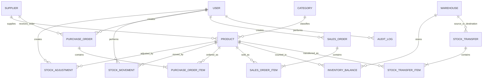

# Warehouse Management API Blueprint

Blueprint ini menggabungkan saran fitur API warehouse, relasi data, rancangan endpoint, dan contoh input/output. Base URL: `http://127.0.0.1:8080/api/v1`.

> Status implementasi di bawah berdasarkan route dan entity yang tersedia saat blueprint ini dibuat. Contoh endpoint usulan adalah desain target, bukan klaim bahwa endpoint tersebut sudah diimplementasikan.

## 1. Format API

### Header

```http
Content-Type: application/json
Authorization: Bearer <jwt>
```

Semua endpoint memerlukan JWT kecuali register dan login. Identitas user untuk audit sebaiknya diambil dari token pada server, bukan dipercayai dari `created_by` yang dikirim client.

### Response sukses

Format mengikuti helper response yang sekarang digunakan backend (`meta` dan `data`):

```json
{
  "meta": {
    "message": "Stock adjustment created",
    "code": 201,
    "status": "success"
  },
  "data": {
    "id": 31,
    "product_id": 12,
    "type": "increase",
    "quantity": 20,
    "balance_before": 45,
    "balance_after": 65,
    "reason": "Hasil stock opname",
    "reference": "OPNAME-2026-014",
    "created_by": 7,
    "created_at": "2026-10-02T09:30:00Z"
  }
}
```

### Response error

Pertahankan envelope yang sama di semua handler:

```json
{
  "meta": {
    "message": "Validation failed",
    "code": 422,
    "status": "error"
  },
  "data": {
    "errors": ["quantity must be greater than 0"]
  }
}
```

Status yang disarankan: `200` untuk pembacaan/perubahan sukses, `201` untuk resource baru, `400` untuk aturan bisnis atau parameter tidak valid, `401` untuk autentikasi, `403` untuk hak akses, `404` untuk resource tidak ditemukan, `409` untuk konflik stok/status, dan `422` untuk validasi body.

## 2. Relasi data



### Catatan relasi

- Relasi yang sudah terlihat di entity saat ini: `Supplier 1:N Product`, `Category 1:N Product`, `Product 1:N Mutation`, dan `User 1:N Mutation`.
- `StockAdjustment` sebaiknya memiliki foreign key `product_id` dan `created_by` ke `Product` dan `User`. Entity yang ada saat ini hanya menyimpan ID sebagai integer, sehingga constraint dan association perlu dipastikan di database/model.
- Stock adjustment dan mutation sebaiknya dicatat dalam satu ledger pergerakan stok atau keduanya menulis ke ledger yang sama. Hindari dua sumber kebenaran stok yang dapat berbeda.
- Konsep multi-warehouse belum ada di model. Jika satu gudang saja, `warehouse_id` dapat ditunda. Jika transfer antar lokasi diperlukan, buat `Warehouse`/`Location` dan `InventoryBalance` sebelum mengimplementasikan transfer.
- Untuk nilai uang, gunakan decimal/numeric di database dan representasi integer satuan terkecil atau string decimal pada API; jangan gunakan floating point.

## 3. Modul yang sudah ada dan API yang perlu dilengkapi

### 3.1 Auth dan user

Route saat ini: `POST /auth/register`, `POST /auth/login`, `GET /user/detail/:id`, `POST /user/update/:id`, `GET /user/data/:id`.

Tambahan yang disarankan:

| Method | Endpoint | Tujuan |
|---|---|---|
| POST | `/auth/logout` | Invalidasi refresh/session token jika mekanisme refresh ditambahkan. |
| POST | `/auth/refresh` | Terbitkan access token baru menggunakan refresh token. |
| POST | `/auth/change-password` | Ganti password dengan password lama dan baru. |
| POST | `/auth/forgot-password` | Memulai alur reset password. |
| POST | `/auth/reset-password` | Menetapkan password menggunakan token reset. |
| GET | `/users` | List user untuk admin, dengan filter/paginasi. |
| PATCH | `/users/:id/role` | Mengubah role dengan otorisasi admin. |

Jangan pernah mengembalikan `PasswordHash` dalam response. Batasi akses user/role management berdasarkan role.

### 3.2 Supplier

Route saat ini: `POST /supplier/create`.

| Method | Endpoint | Tujuan |
|---|---|---|
| GET | `/suppliers` | List/search/paginasi supplier. |
| GET | `/suppliers/:id` | Detail supplier. |
| PATCH | `/suppliers/:id` | Update data supplier. |
| DELETE | `/suppliers/:id` | Soft delete/nonaktifkan supplier; tolak jika masih dipakai transaksi aktif. |
| GET | `/suppliers/:id/products` | Produk yang dipasok supplier. |
| GET | `/suppliers/:id/purchase-orders` | Riwayat PO supplier. |

### 3.3 Category

Route saat ini: `GET /categories`, `GET /category/:id`, `POST /category`.

| Method | Endpoint | Tujuan |
|---|---|---|
| PATCH | `/categories/:id` | Ubah nama kategori. |
| DELETE | `/categories/:id` | Soft delete kategori jika tidak ada produk aktif yang bergantung. |
| GET | `/categories/:id/products` | List produk dalam kategori. |

### 3.4 Product dan inventory

Route saat ini: `POST /product/create`, `GET /product/supplier/:supplier_id`, `GET /Products`, `GET /product/:id`, `PUT /product/update/:id`.

Saran konsolidasi nama route ke plural REST-style secara bertahap, dengan kompatibilitas sementara untuk client lama:

| Method | Endpoint target | Tujuan |
|---|---|---|
| GET | `/products` | List dengan search, filter, sort, pagination. |
| POST | `/products` | Buat produk. |
| GET | `/products/:id` | Detail produk. |
| PATCH | `/products/:id` | Update sebagian field produk. |
| DELETE | `/products/:id` | Soft delete/nonaktifkan produk. |
| PATCH | `/products/:id/restore` | Restore produk nonaktif. |
| GET | `/products/:id/stock` | Posisi stok produk. |
| GET | `/products/:id/stock-movements` | Riwayat gerak stok produk. |
| GET | `/inventory/low-stock` | Produk dengan stok di bawah minimum. |

Contoh filter list:

`GET /products?search=keyboard&category_id=2&supplier_id=4&stock_below_min=true&page=1&limit=20&sort=name&order=asc`

Contoh input create:

```json
{
  "sku": "KB-001",
  "name": "Keyboard USB",
  "category_id": 2,
  "supplier_id": 4,
  "stock": 25,
  "min_stock": 5,
  "unit": "pcs",
  "image": "https://example.test/items/kb-001.jpg"
}
```

Sebaiknya create produk tidak menerima object `Category` penuh; cukup ID relasi `category_id`. Validasi bahwa kategori dan supplier tersebut benar-benar ada.

### 3.5 Stock adjustment

Route saat ini terdaftar: `POST /inventory/stock-adjustments`, `GET /inventory/stock-adjustments`, `GET /inventory/stock-adjustments/:id`, `GET /inventory/products/:product_id/stock-adjustments`.

Entity/input/repository sudah tersedia, tetapi handler belum ditemukan di folder `stockadjustment`, dan service saat ini menyimpan adjustment tanpa mengubah stock produk. Sebelum dianggap selesai, implementasikan handler dan operasi stok atomik.

Aturan domain:

- `type` hanya `increase` atau `decrease`.
- `quantity` wajib lebih besar dari nol.
- Stok akhir tidak boleh negatif.
- `created_by` diturunkan dari user di JWT, bukan body request.
- Update stok dan insert adjustment dilakukan dalam satu transaksi database.
- Simpan `balance_before` dan `balance_after` untuk audit yang mudah dibaca.

| Method | Endpoint | Tujuan |
|---|---|---|
| POST | `/inventory/stock-adjustments` | Buat adjustment dan update saldo stok secara atomik. |
| GET | `/inventory/stock-adjustments` | List dengan filter product/type/date/page/limit. |
| GET | `/inventory/stock-adjustments/:id` | Detail adjustment. |
| GET | `/inventory/products/:product_id/stock-adjustments` | Riwayat adjustment produk. |

Request:

```json
{
  "product_id": 12,
  "type": "decrease",
  "quantity": 3,
  "reason": "Barang rusak saat pemeriksaan",
  "reference": "QC-2026-021"
}
```

Response sukses menggunakan contoh envelope pada bagian Format API. `created_by`, waktu, dan saldo awal/akhir harus ditetapkan server.

### 3.6 Stock transfer dan warehouse/location

Fitur ini hanya diperlukan jika ada lebih dari satu gudang/lokasi. Tambahkan entity `Warehouse`/`Location`, saldo stok per lokasi (`InventoryBalance` dengan unique key `warehouse_id + product_id`), transfer header, dan transfer items.

| Method | Endpoint | Tujuan |
|---|---|---|
| GET | `/warehouses` | List lokasi gudang. |
| POST | `/warehouses` | Buat lokasi. |
| GET | `/warehouses/:id` | Detail lokasi. |
| PATCH | `/warehouses/:id` | Update lokasi. |
| POST | `/inventory/transfers` | Buat transfer stok. |
| GET | `/inventory/transfers` | List transfer dengan filter status/tanggal. |
| GET | `/inventory/transfers/:id` | Detail transfer dan items. |
| POST | `/inventory/transfers/:id/approve` | Approve transfer, bila workflow memerlukannya. |
| POST | `/inventory/transfers/:id/dispatch` | Kurangi stok asal dan tandai in-transit secara atomik. |
| POST | `/inventory/transfers/:id/receive` | Tambah stok tujuan sesuai kuantitas diterima. |
| POST | `/inventory/transfers/:id/cancel` | Batalkan transfer sesuai status yang diizinkan. |

Request:

```json
{
  "from_warehouse_id": 1,
  "to_warehouse_id": 2,
  "note": "Penyeimbangan stok cabang",
  "items": [
    {"product_id": 12, "quantity": 10},
    {"product_id": 15, "quantity": 4}
  ]
}
```

Response ringkas:

```json
{
  "meta": {"message": "Transfer created", "code": 201, "status": "success"},
  "data": {
    "id": 44,
    "status": "draft",
    "from_warehouse_id": 1,
    "to_warehouse_id": 2,
    "items": [
      {"product_id": 12, "quantity": 10},
      {"product_id": 15, "quantity": 4}
    ]
  }
}
```

### 3.7 Purchase order (PO)

PO merepresentasikan permintaan barang ke supplier; penerimaan barang harus mencatat stok masuk dan mendukung penerimaan parsial.

| Method | Endpoint | Tujuan |
|---|---|---|
| POST | `/purchase-orders` | Buat PO draft beserta items. |
| GET | `/purchase-orders` | List/filter status, supplier, tanggal, pagination. |
| GET | `/purchase-orders/:id` | Detail PO beserta items dan penerimaan. |
| PATCH | `/purchase-orders/:id` | Edit PO selama masih draft. |
| POST | `/purchase-orders/:id/submit` | Ajukan/submit PO. |
| POST | `/purchase-orders/:id/approve` | Approve PO berdasarkan role. |
| POST | `/purchase-orders/:id/cancel` | Batalkan PO jika status memungkinkan. |
| POST | `/purchase-orders/:id/receipts` | Catat penerimaan penuh atau parsial. |
| GET | `/purchase-orders/:id/receipts` | Riwayat penerimaan PO. |

Request create:

```json
{
  "supplier_id": 4,
  "expected_at": "2026-10-10T00:00:00Z",
  "notes": "Pengadaan stok bulanan",
  "items": [
    {"product_id": 12, "quantity_ordered": 50, "unit_cost": "120000.00"},
    {"product_id": 15, "quantity_ordered": 20, "unit_cost": "95000.00"}
  ]
}
```

Request receive sebagian:

```json
{
  "warehouse_id": 1,
  "received_at": "2026-10-08T10:15:00Z",
  "items": [
    {"purchase_order_item_id": 1, "quantity_received": 30},
    {"purchase_order_item_id": 2, "quantity_received": 20}
  ],
  "note": "Sisa item pertama menyusul"
}
```

Response:

```json
{
  "meta": {"message": "Goods received", "code": 201, "status": "success"},
  "data": {
    "receipt_id": 91,
    "purchase_order_id": 77,
    "status": "partially_received",
    "items": [
      {"product_id": 12, "quantity_received": 30, "stock_after": 80},
      {"product_id": 15, "quantity_received": 20, "stock_after": 42}
    ]
  }
}
```

Aturan penting: stok bertambah saat receipt diposting, bukan saat PO dibuat/diapprove. Update saldo, receipt, dan stock movement harus berada dalam satu transaksi.

### 3.8 Sales order (SO) / outbound

Modul ini mencatat pesanan barang keluar. Bila aplikasi hanya mengelola stok internal dan belum menangani pelanggan, modul ini dapat ditunda.

| Method | Endpoint | Tujuan |
|---|---|---|
| POST | `/sales-orders` | Buat order draft dengan items. |
| GET | `/sales-orders` | List/filter status/tanggal/customer. |
| GET | `/sales-orders/:id` | Detail order. |
| PATCH | `/sales-orders/:id` | Edit order selama draft. |
| POST | `/sales-orders/:id/confirm` | Konfirmasi dan cek ketersediaan stok. |
| POST | `/sales-orders/:id/shipments` | Catat barang yang benar-benar dikirim. |
| GET | `/sales-orders/:id/shipments` | Riwayat shipment. |
| POST | `/sales-orders/:id/cancel` | Batalkan sesuai status. |

Request create:

```json
{
  "customer": {"name": "PT Maju Jaya", "phone": "08123456789"},
  "delivery_address": "Jl. Merdeka No. 10",
  "items": [
    {"product_id": 12, "quantity_ordered": 5, "unit_price": "150000.00"}
  ]
}
```

Request shipment:

```json
{
  "warehouse_id": 1,
  "shipped_at": "2026-10-09T14:00:00Z",
  "items": [
    {"sales_order_item_id": 1, "quantity_shipped": 5}
  ],
  "tracking_number": "SHIP-2026-0091"
}
```

Response shipment:

```json
{
  "meta": {"message": "Shipment created", "code": 201, "status": "success"},
  "data": {
    "shipment_id": 62,
    "sales_order_id": 88,
    "status": "shipped",
    "items": [
      {"product_id": 12, "quantity_shipped": 5, "stock_after": 20}
    ]
  }
}
```

Jangan mengurangi stok saat SO draft dibuat. Kurangi saat shipment diposting, dengan validasi stok dan transaksi atomik. Untuk reservasi stok saat confirm, buat aturan reservasi eksplisit.

### 3.9 Stock opname

Opname membandingkan jumlah fisik dan jumlah sistem, lalu membuat adjustment untuk selisih. Hindari mengubah stok langsung tanpa audit.

| Method | Endpoint | Tujuan |
|---|---|---|
| POST | `/inventory/stocktakes` | Buat sesi opname. |
| GET | `/inventory/stocktakes` | List sesi opname. |
| GET | `/inventory/stocktakes/:id` | Detail sesi dan hasil hitung. |
| PUT | `/inventory/stocktakes/:id/counts` | Simpan hitungan fisik per produk. |
| POST | `/inventory/stocktakes/:id/submit` | Finalisasi; buat adjustment untuk selisih. |
| POST | `/inventory/stocktakes/:id/cancel` | Batalkan sesi yang belum difinalisasi. |

Request count:

```json
{
  "counts": [
    {"product_id": 12, "counted_quantity": 62, "note": "1 pcs ditemukan di rak B"},
    {"product_id": 15, "counted_quantity": 40, "note": "Sesuai"}
  ]
}
```

Response item:

```json
{
  "product_id": 12,
  "system_quantity": 60,
  "counted_quantity": 62,
  "difference": 2,
  "adjustment_id": 102
}
```

### 3.10 Dashboard dan reports

| Method | Endpoint | Query penting |
|---|---|---|
| GET | `/dashboard/summary` | `from`, `to`, `warehouse_id` |
| GET | `/dashboard/low-stock` | `page`, `limit`, `category_id` |
| GET | `/dashboard/stock-by-category` | `warehouse_id` |
| GET | `/dashboard/movement-summary` | `period=day|week|month`, `from`, `to` |
| GET | `/reports/stock-movements` | `product_id`, `type`, `from`, `to`, `page`, `limit` |
| GET | `/reports/top-products` | `metric=outbound|inbound`, `from`, `to`, `limit` |
| GET | `/reports/inventory-valuation` | `warehouse_id`, `as_of` |
| GET | `/reports/stock-movements/export` | filter yang sama, `format=csv` |

Contoh summary response:

```json
{
  "meta": {"message": "Dashboard summary", "code": 200, "status": "success"},
  "data": {
    "total_products": 230,
    "total_stock_units": 15420,
    "low_stock_products": 12,
    "active_suppliers": 18,
    "inbound_movements_today": 27,
    "outbound_movements_today": 19
  }
}
```

### 3.11 Audit log

| Method | Endpoint | Tujuan |
|---|---|---|
| GET | `/audit-logs` | List dengan filter entity/action/user/date/page/limit. |
| GET | `/audit-logs/:id` | Detail satu log. |

Contoh response data:

```json
{
  "id": 501,
  "entity_type": "product",
  "entity_id": 12,
  "action": "updated",
  "actor_id": 7,
  "changes": {
    "min_stock": {"before": 5, "after": 8}
  },
  "created_at": "2026-10-02T12:00:00Z"
}
```

Audit log bersifat append-only untuk aplikasi biasa. Batasi aksesnya ke admin/manager dan jangan catat password, token, atau data sensitif.

### 3.12 Upload gambar produk

| Method | Endpoint | Tujuan |
|---|---|---|
| POST | `/products/:id/image` | Upload/update gambar produk menggunakan `multipart/form-data`, field `image`. |
| DELETE | `/products/:id/image` | Hapus gambar produk. |

Validasi tipe file, ukuran maksimum, nama file acak, dan simpan file di object storage atau lokasi terpisah dari executable. Jangan menerima path file dari client.

## 4. Parameter list yang konsisten

Gunakan pada semua endpoint collection bila sesuai:

- `page` default `1`, minimal `1`.
- `limit` default `20`, batasi maksimum misalnya `100`.
- `sort` hanya menerima daftar kolom yang diizinkan.
- `order` hanya `asc` atau `desc`.
- filter tanggal format RFC3339 atau tanggal ISO yang didokumentasikan.

Contoh response paginasi:

```json
{
  "meta": {"message": "Products", "code": 200, "status": "success"},
  "data": {
    "items": [],
    "pagination": {"page": 1, "limit": 20, "total_rows": 0, "total_pages": 0}
  }
}
```

Jangan interpolasikan nama kolom `sort` langsung ke SQL; cocokkan dengan allowlist.

## 5. Model database minimum untuk modul baru

- `products`: tambahkan soft delete (`deleted_at`) bila dibutuhkan.
- `stock_adjustments`: `id`, `product_id`, `type`, `quantity`, `balance_before`, `balance_after`, `reason`, `reference`, `created_by`, `created_at`.
- `stock_movements`: ledger immutable: `product_id`, `warehouse_id` nullable untuk single warehouse, `source_type`, `source_id`, `direction`, `quantity`, `balance_after`, `performed_by`, `created_at`.
- `warehouses`: `id`, `code`, `name`, `address`, `is_active`.
- `inventory_balances`: `warehouse_id`, `product_id`, `quantity`, unique `(warehouse_id, product_id)`.
- `purchase_orders` dan `purchase_order_items`, ditambah `goods_receipts` dan `goods_receipt_items` untuk penerimaan parsial.
- `sales_orders` dan `sales_order_items`, ditambah `shipments` dan `shipment_items`.
- `stock_transfers` dan `stock_transfer_items` untuk transfer antar gudang.
- `stocktakes` dan `stocktake_counts` untuk opname.
- `audit_logs` untuk jejak perubahan lintas modul.

Semua foreign key harus punya constraint. Untuk operasi yang mengubah saldo, gunakan transaksi database dan locking/atomic update agar dua request bersamaan tidak membuat stok negatif atau lost update.

## 6. Prioritas implementasi

### P0 - integritas stok

1. Selesaikan stock adjustment: handler, relasi `Product`/`User`, transaksi atomik, stok sebelum/sesudah, dan penolakan stok negatif.
2. Satukan semua perubahan stok ke stock movement ledger.
3. Tambah validasi stok, foreign key, status code konsisten, dan test integration untuk concurrent/invalid stock changes.
4. Tambahkan low-stock endpoint dan pencarian/filter/paginasi produk.

### P1 - arus barang

1. Purchase order dengan approval dan penerimaan parsial.
2. Stock opname yang memfinalisasi selisih melalui adjustment.
3. Sales order/shipment jika ada proses pemenuhan pesanan pelanggan.

### P2 - multi lokasi dan kontrol

1. Warehouse/location dan inventory balance per lokasi.
2. Stock transfer dengan dispatch/receive flow.
3. Role-based permission dan audit log.

### P3 - pelaporan dan operasional

1. Dashboard/reports/export.
2. Soft delete/restore.
3. Upload gambar produk yang aman.
4. Notification untuk low stock dan status PO/transfer.

## 7. Keputusan desain yang perlu ditetapkan

- Apakah aplikasi mengelola satu gudang atau banyak lokasi? Bila satu, tunda transfer dan `warehouse_id`; bila banyak, jadikan saldo per warehouse sejak awal.
- Apakah modul sales order memang termasuk ruang lingkup? Jika tidak, outbound dapat dicatat melalui mutation yang dibatasi dan tervalidasi.
- Apakah stok dikurangi saat order dikonfirmasi (reservasi) atau saat barang dikirim? Tetapkan satu aturan dan dokumentasikan state transition.
- Siapa yang boleh membuat/approve PO, melakukan adjustment, mengirim barang, dan melihat audit/report?
- Apakah penerimaan/pengiriman mendukung kuantitas parsial dan pembatalan?

## 8. Kriteria selesai untuk stock adjustment

- Input tidak menerima quantity nol/negatif atau tipe selain `increase`/`decrease`.
- User ID berasal dari JWT, bukan body.
- Product harus ada; decrease tidak boleh menghasilkan stok negatif.
- Perubahan stok dan pencatatan adjustment/movement sukses atau gagal bersama-sama dalam transaksi.
- Response memakai format `meta` + `data`.
- Ada test untuk increase, decrease, saldo tidak cukup, product tidak ada, input invalid, tanpa token, dan dua request bersamaan.
